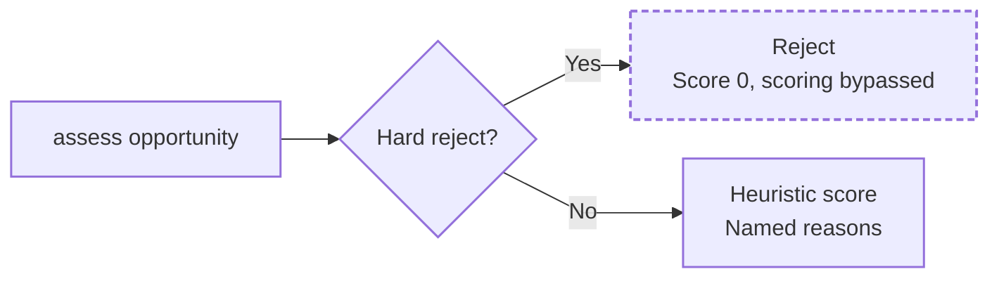
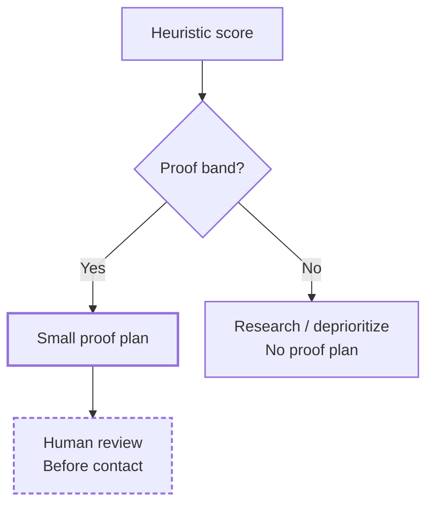

# Opportunity Intelligence Core

When I look at a pile of possible opportunities, half the problem is deciding which one deserves attention first.

This is a Python experiment in making that choice **explainable** instead of just assigning each lead a mysterious 92/100 and acting impressed by it.

First it checks hard eligibility conditions. Only eligible items reach the scoring rubric. Then it records which reasons added or removed points and puts the result in a review band.

| Score | What the code suggests |
| --- | --- |
| 75–100 | Prepare a small proof |
| 55–74 | Verify what is missing, then prepare |
| 35–54 | Research further |
| 0–34 | Deprioritize |
| Hard reject | Stop before scoring |

If it prepares proof, the last step is **human review before contact**. The module does not send applications or messages.

## A score is not a crystal ball

The weights (22, 16, 12, and so on) are hand-chosen policy constants. They are **not** learned from hiring results or calibrated success probabilities. A score of 83 means "the rubric says inspect this sooner," not "83% chance of getting paid."

The eligibility rules also include geography and remote-status gates. Whether those are the *right* gates for a particular search is a policy decision — not a fact established by this library.

I also added URL normalization: tracking-only differences can collapse to one candidate while identity-bearing query values stay distinct. Otherwise half the work would be prioritizing the same opportunity six times.

## The two-step triage

Eligibility gets a veto *before* anybody calculates a score.

A high scoring item becomes a proof plan, not an automatic contact.

[Eligibility](src/opportunity_intelligence/gates.py) · [scoring](src/opportunity_intelligence/scoring.py) · [planning](src/opportunity_intelligence/planning.py) · [normalization](src/opportunity_intelligence/normalization.py) · [tests](tests/).

No account access, recruiter messaging, real submissions, payment, or claimed predictive performance. It's a deterministic triage core. [Verification](docs/verification.md) · [provenance](PROVENANCE.md).
